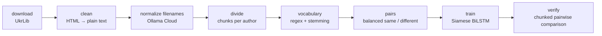
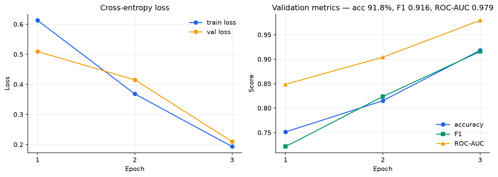
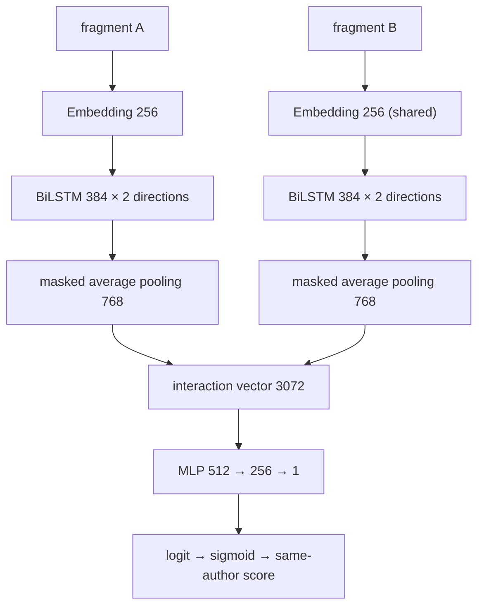

<div align="center">

# Ukrainian Authorship Verification

**Given two fragments of Ukrainian text, decide whether they were written by the same author.**

A diploma project built into a complete ML pipeline and Python CLI: corpus preparation, Siamese BiLSTM training, baseline comparison, and fragment verification.

[](https://www.python.org/)
[](https://pytorch.org/)
[](#results)
[](https://docs.astral.sh/ruff/)

[Pipeline](#pipeline) · [Results](#results) · [Quickstart](#quickstart) · [Model](#model) · [CLI](#cli) · [Baseline](#baseline)

</div>

The project brings together:

- **Corpus preparation:** cached downloads, HTML extraction, and LLM-assisted filename normalization through Ollama Cloud.
- **Neural verification:** a shared BiLSTM encoder trained from scratch on balanced same-author and different-author pairs.
- **Comparable evaluation:** seeded splits and pair generation shared with a TF-IDF + cosine baseline.
- **Recorded experiments:** YAML configuration, checkpoint selection, per-epoch XML reports, and training curves.
- **Practical inference:** multiple text files, long-fragment chunking, configurable score aggregation, and text or JSON output.

## Pipeline



The current corpus list uses **UkrLib**. Text extraction is handled by BeautifulSoup; tokenization preserves punctuation and applies lightweight Ukrainian stemming.

**Ollama Cloud was used during corpus preparation to normalize book filenames.** The current default is [`nemotron-3-ultra:cloud`](https://ollama.com/library/nemotron-3-ultra). The renamer sends filenames to the model and requests a JSON mapping to `author-slug-N.txt`, retaining names and patronymics so books can be grouped by author. Book contents stay in the local cleaning and training pipeline. Successful downloads and processed filenames are cached for subsequent runs.

See the [download pipeline](src/authorship/parsing/parser.py), [text cleaner](src/authorship/parsing/cleaner.py), and [Ollama renamer](src/authorship/parsing/book_renamer.py).

## Results

| Data and evaluation | Recorded run |
|---|---|
| Authors retained for training | 22 |
| Chunks per author | 300 |
| Training pairs | 11,000 |
| Validation pairs | 6,600 |
| Pair balance | 50% same author / 50% different authors |
| Train / validation split | 80/20 chunks within each author |

Seed **2026**, **3 epochs**, **260.5 s** (about 4 min 21 s) on an **RTX 4060**, using Python 3.12 and PyTorch 2.14.0 with CUDA. Metrics use a fixed threshold of **0.5** and the checkpoint with minimum validation loss.

| Metric | Value |
|---|---|
| **Accuracy** | **91.8%** |
| F1 | 0.916 |
| Precision | 0.944 |
| Recall | 0.889 |
| ROC-AUC | 0.979 |



The TF-IDF baseline is fitted on training chunks and evaluated on **the same validation texts, pairs, and labels** as the BiLSTM.

| Approach | Accuracy | F1 | ROC-AUC |
|---|---|---|---|
| TF-IDF + cosine, threshold 0.035 | 69.6% | 0.696 | 0.757 |
| **Siamese BiLSTM**, threshold 0.5 | **91.8%** | **0.916** | **0.979** |

The baseline threshold of 0.035 was retained from an earlier experiment. It was not retuned on this validation split; ROC-AUC is independent of the decision threshold.

*Evaluation context:* books are grouped by author before chunking, so chunks from the same work may appear in both sets. The validation split is used for configuration and checkpoint selection. These results describe that setup; evaluation on unseen books or unseen authors remains a separate step.

## Quickstart

Run the commands below from the repository root. The corpus and trained checkpoint are generated locally and are not included in the repository.

**Requirements:** Python 3.11+, [Ollama](https://ollama.com/download), an Ollama account for cloud models, and internet access for corpus preparation. A CUDA-capable GPU is recommended for training; the CLI uses CPU when CUDA is unavailable.

### 1. Install the package

```bash
python3 -m venv .venv
source .venv/bin/activate
python -m pip install -e .
```

These activation commands are for Linux/macOS. In Windows PowerShell, use `.venv\Scripts\Activate.ps1`.

For CUDA, install a PyTorch build suited to your GPU and driver using the [official installation selector](https://pytorch.org/get-started/locally/). Check GPU availability in the active environment:

```bash
python -c "import torch; print('CUDA available:', torch.cuda.is_available())"
```

### 2. Set up Ollama Cloud

Start the Ollama application or service. If you run it manually, keep `ollama serve` running in a separate terminal. The Python client connects to `http://localhost:11434` by default.

Sign in and check the model used by the renamer:

```bash
ollama signin
ollama run nemotron-3-ultra:cloud "Reply with OK."
```

The LLM runs in **Ollama Cloud** through the local Ollama service, so corpus renaming does not require downloading large model weights. This is the cloud-backed setup used for corpus preparation; see the [Ollama Cloud guide](https://docs.ollama.com/cloud). Once the corpus is prepared, BiLSTM training and verification run locally without Ollama.

### 3. Prepare the corpus and train

```bash
authorship download --train
authorship train --config experiments/default.yaml
authorship plot
```

`download --train` performs downloading, cleaning, and renaming. Training then groups books by author, creates the chunk split and balanced pairs, builds the training vocabulary, and fits the model.

The default configuration is in [`experiments/default.yaml`](experiments/default.yaml). It contains model, training, data, inference, and seed settings. Local outputs are:

| Artifact | Path |
|---|---|
| Best checkpoint, including vocabulary | `experiments/siamese_full_package.pth` |
| Per-epoch training report | `experiments/training_report.xml` |
| Vocabulary cache | `experiments/vocab_cache.json` |
| Training figure | `docs/assets/training_curves.png` |

### 4. Compare two fragments

Save two Ukrainian text fragments as UTF-8 files, `fragment_a.txt` and `fragment_b.txt`, then run:

```bash
authorship verify fragment_a.txt fragment_b.txt
```

The command reports the same-author score and a verdict. For machine-readable output:

```bash
authorship verify fragment_a.txt fragment_b.txt --output json -o comparison.json
```

## Model

Both fragments pass through the same encoder with shared weights. Their representations are combined and passed to a classifier producing a same-author score.



The interaction vector contains the two encodings, their absolute difference, and their element-wise product:

$$\mathbf{z} = [\,\mathbf{u};\ \mathbf{v};\ |\mathbf{u}-\mathbf{v}|;\ \mathbf{u}\odot\mathbf{v}\,] \in \mathbb{R}^{3072}$$

The default model has **23.1 million parameters**, a maximum input length of **1,000 tokens**, classifier dropout of **0.35**, and embedding dropout of **0.2**. Training uses `BCEWithLogitsLoss`, AdamW with learning rate **0.0003** and weight decay **0.0001**, batch size **32**, and gradient clipping at norm **1.0**.

Implementation: [model](src/authorship/model.py), [training loop](src/authorship/train.py), [pair generation](src/authorship/pairs.py), and [vocabulary](src/authorship/vocabulary.py).

## CLI

| Command | Purpose |
|---|---|
| `authorship download --train` | Download, clean, and rename the training corpus |
| `authorship download --validation` | Prepare additional books for manual comparisons |
| `authorship rename --train` | Normalize filenames in an existing training corpus |
| `authorship train --config experiments/default.yaml` | Train with YAML configuration |
| `authorship plot` | Render the training report |
| `authorship verify a.txt b.txt` | Compare text fragments |

The additional books downloaded with `--validation` are stored under `content/raw/ukr_data/test_data`. They are separate from the 80/20 validation split used for the metrics above.

`verify` accepts two or more `.txt` files and compares every file pair. Long fragments are split into chunks; each chunk pair is scored, then the scores are aggregated. The default aggregation is arithmetic mean; geometric mean, harmonic mean, and median are also available.

```bash
# Show progress for long fragments and choose aggregation.
authorship verify fragment_a.txt fragment_b.txt --aggregation median --progress

# Supply a checkpoint and override the decision threshold.
authorship verify fragment_a.txt fragment_b.txt \
  --checkpoint experiments/siamese_full_package.pth \
  --config experiments/default.yaml --threshold 0.5

# Save a training plot to a different path.
authorship plot --report experiments/training_report.xml -o training_curves.png

# List available options.
authorship --help
authorship verify --help
```

The default `verify` threshold is **0.65** for aggregated scores. Training validation metrics use **0.5** on individual chunk pairs. A score above the chosen threshold yields `SAME AUTHOR`.

<details>
<summary>Real CLI output: different-author validation fragments</summary>

```text
=== Author Verification ===
Checkpoint: experiments/siamese_full_package.pth
Threshold:  0.65 | Aggregation: arithmetic

--- Comparison 1/1 ---
  A: "different_a" (408 tokens → 1 chunks)
  B: "different_b" (938 tokens → 1 chunks)
  Pairwise: [0.0048]
  Score: 0.0048
  Result: DIFFERENT AUTHORS ✗

=== Summary: 0 same, 1 different ===
```

</details>

## Baseline

TF-IDF + cosine similarity provides a classical reference for the neural model. It runs on CPU and needs the prepared corpus, but no BiLSTM checkpoint.

```bash
python -m authorship.baseline --config experiments/default.yaml --threshold 0.035
```

The baseline shares the shuffled chunk split and pair-generation helpers with training. TF-IDF is fitted on training chunks only. With the same corpus, seed, and pair settings, both methods evaluate identical validation pairs.

Optional arguments include a corpus directory, `--samples`, `--train-samples`, `--target-count`, and `--seed`. Keep their values aligned with the BiLSTM configuration when comparing results. The baseline's default threshold is 0.5; the command above uses the reported 0.035 threshold.

Implementation: [`src/authorship/baseline.py`](src/authorship/baseline.py).

## Development

```bash
python -m pip install -e ".[dev]"
pytest
ruff check src tests
ruff format --check src tests
```

The test suite covers text cleaning, vocabulary handling, CLI input and output, chunking and aggregation, report rendering, and alignment of baseline and training validation pairs.

<details>
<summary>Project structure</summary>

```text
src/authorship/
├── cli.py            # download / rename / train / plot / verify commands
├── config.py         # YAML configuration and seed handling
├── baseline.py       # TF-IDF + cosine reference
├── model.py          # shared BiLSTM encoder and classifier
├── train.py          # training loop, checkpoints, XML reports
├── predict.py        # checkpoint loading and pair inference
├── pairs.py          # shared split, pair generation, dataset
├── vocabulary.py     # tokenization, stemming, vocabulary cache
├── reporting.py      # training report → figures
├── metrics.py        # metrics accumulator
└── parsing/
    ├── book_sources.py    # corpus URL lists
    ├── cleaner.py         # HTML and text cleaning
    ├── book_renamer.py    # Ollama filename normalization
    ├── divider.py         # author grouping and chunking
    ├── downloader.py      # source downloads
    ├── constants.py       # corpus and cache paths
    └── parser.py          # download → clean → rename pipeline
```

</details>

## License

All rights reserved.
